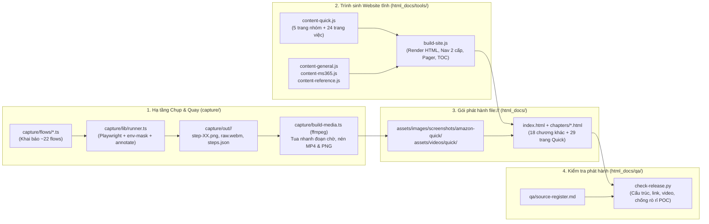

# Bản thiết kế Giai đoạn 2 — Làm lại phần Amazon Quick (Chương 11–15) trong Cẩm nang nội bộ NAB

---

## 1. Tóm tắt hướng tiếp cận

Giải pháp thực hiện Giai đoạn 2 dựa trên **Phương án B đã duyệt** ([analysis/de-cuong-phuong-an-b.md](file:///home/toannk/project/nab/ai-docs/analysis/de-cuong-phuong-an-b.md)), kết hợp với các điều chỉnh bắt buộc về phân nhóm người dùng, trọng tâm tra cứu/chia sẻ và phạm vi Non-goals:

1. **Cấu trúc phân cấp 2 tầng (5 chương nhóm + 24 trang việc con)**:
   - Giữ nguyên số thứ tự và tên file của các chương `01–10` và `16–23`.
   - Đổi 5 chương `11–15` thành **5 trang nhóm** (tổng quan nhóm tính năng, nguyên tắc kiểm soát NAB chung, bảng điều hướng nhanh vào các việc).
   - Tách từng thao tác thành **24 trang con đánh số `NN.x`** (ví dụ `11.1`, `11.2`, ..., `15.4`), mỗi trang giải quyết trọn vẹn 1 việc với **ảnh từng bước có khoanh đỏ + số thứ tự ①②③** và **1 video ngắn (30–90 giây)** chạy trực tiếp qua giao thức `file://`.
2. **Phân tầng rõ 2 nhóm người dùng NAB & trọng tâm tra cứu/chia sẻ**:
   - **Mọi user**: toàn bộ các trang về Đăng nhập & Chat (`11.1–11.5`), Space & Chat agent (`12.1–12.7` — gồm cả tạo Space, tạo Agent), Research (`14.1–14.2`), và Flow (`15.1–15.2` — gồm chạy và tạo Flow) được mở hướng dẫn chuẩn cho toàn bộ nhân viên (gỡ nhãn `[cần SME]` cũ).
   - **User Reader (chỉ xem)**: xem và đặt câu hỏi trên Dashboard (`13.1`), hỏi đáp với dữ liệu được chia sẻ (`13.2`).
   - **Tính năng giới hạn user (`*`)**: các trang `13.3*` (Scenarios), `13.4*` (Stories), `13.5*` (Tạo dataset), `13.6*` (Tạo analysis & publish dashboard), `15.3*` (Tạo app), `15.4*` (Automations) vẫn có hướng dẫn chi tiết kèm ảnh/video nhưng gắn dấu `*` ở tên mục sidebar/tiêu đề và hiển thị hộp thông báo chuẩn: *"Tính năng này giới hạn user — chỉ dành cho nhân sự được cấp quyền bổ sung tại NAB"*.
   - **Tăng cường phần Chia sẻ**: bổ sung trang `12.6` (*Chia sẻ chat agent*) và trang `12.7` (*Lưu ý chung khi chia sẻ Agent, Space và tài nguyên Quick*) để giải quyết rủi ro phân quyền, RLS/CLS, tài liệu tham chiếu gắn kèm agent/Space.
3. **Bảo toàn 100% nội dung kiểm soát đặc thù NAB & loại bỏ lỗi dịch máy**:
   - Toàn bộ quy định đặc thù NAB đã kiểm kê tại [analysis/current-quick-content.md](file:///home/toannk/project/nab/ai-docs/analysis/current-quick-content.md#L571-L829) được ánh xạ đầy đủ vào các trang nhóm và trang việc.
   - Tắt bộ regex thay từ tự động `normalizeChapterCopy()` trong [html_docs/tools/build-site.js](file:///home/toannk/project/nab/ai-docs/html_docs/tools/build-site.js#L390-L406) riêng cho các trang Amazon Quick (vốn gây lỗi dịch nhãn giao diện như `"All data"` → `"All dữ liệu"`, `"New analysis"` → `"New phân tích"`), nhưng giữ nguyên hàm này cho các chương `01–10` và `16–22`.
4. **Quy trình chụp/quay tự động hoá & đóng gói tối ưu dung lượng**:
   - Mở rộng hạ tầng Playwright trong [capture/](file:///home/toannk/project/nab/ai-docs/capture/run.ts) để tự động ẩn các mục chỉ dành cho Admin (như dòng `Manage account` trong menu tài khoản) bên cạnh bộ che `nab-quick-poc` → `opba-ai` ([capture/lib/env-mask.ts](file:///home/toannk/project/nab/ai-docs/capture/lib/env-mask.ts)).
   - Bổ sung bước hậu kỳ tự động bằng `ffmpeg` đọc mốc `waits` từ `steps.json` để tua nhanh (`4x–8x`) các đoạn chờ hệ thống xử lý và nén video sang H.264 MP4 (`720p/1080p`, CRF 28–30, không âm thanh, `1.5–4 MB/video`), đảm bảo tổng dung lượng gói `html_docs/` nhỏ gọn trên shared folder nội bộ.

---

## 2. Kiến trúc & thành phần

### 2.1 Sơ đồ kiến trúc tổng thể



### 2.2 Các thành phần cần xây dựng / cập nhật

| Thành phần | Đường dẫn file | Vai trò & Thay đổi chính |
|---|---|---|
| **Dữ liệu nội dung Quick** | [html_docs/tools/content-quick.js](file:///home/toannk/project/nab/ai-docs/html_docs/tools/content-quick.js) | Viết lại toàn bộ thành mảng 29 đối tượng trang (5 chương nhóm `11–15` + 24 trang con `11.1–15.4`). Viết tiếng Việt chuẩn, giữ nguyên nhãn UI tiếng Anh trong ngoặc/in đậm, gắn cờ `skipNormalize: true`. |
| **Trình build HTML tĩnh** | [html_docs/tools/build-site.js](file:///home/toannk/project/nab/ai-docs/html_docs/tools/build-site.js) | Hỗ trợ `id` chuỗi (`"11.1"`), `parentId` (`11`), `limitedUser` (`true/false`); render sidebar 2 cấp cho nhóm Quick; render breadcrumb 4 cấp cho trang con; render các component mới (bước có ảnh, khối video, khối Sai/Đúng, bảng xử lý lỗi, nhãn giới hạn user). |
| **Giao diện & CSS** | [html_docs/assets/css/style.css](file:///home/toannk/project/nab/ai-docs/html_docs/assets/css/style.css) | Thêm style cho `.subchapter-nav`, `.limited-badge`, `.limited-user-notice`, `.steps-figured`, `.video-figure`, `.compare-grid` (`.compare-wrong`, `.compare-right`), và `@media print` ẩn thẻ `<video>`. |
| **Tương tác Client (`file://`)** | [html_docs/assets/js/site.js](file:///home/toannk/project/nab/ai-docs/html_docs/assets/js/site.js) | Cập nhật `filterNavigation()` để khi tìm kiếm `Ctrl+K` khớp trang con thì giữ hiển thị mục chương nhóm cha; tự động dừng phát video nếu người dùng mở modal phóng to ảnh. |
| **Bộ che POC & ẩn Admin UI** | [capture/lib/env-mask.ts](file:///home/toannk/project/nab/ai-docs/capture/lib/env-mask.ts), [capture/lib/browser/mask.js](file:///home/toannk/project/nab/ai-docs/capture/lib/browser/mask.js) | Bổ sung quy tắc CSS/DOM tự động ẩn các nút/dòng quản trị của tài khoản test Admin (ví dụ dòng `Manage account` trong menu tài khoản) để ảnh/video phản ánh đúng màn hình user thường. |
| **Kịch bản chụp/quay** | `capture/flows/*.ts` | Hoàn thiện 4 flow đăng nhập và viết mới ~18 flow thao tác cho các trang việc từ chương 11 đến 15, dùng dữ liệu giả trong [capture/samples/](file:///home/toannk/project/nab/ai-docs/capture/samples/make-samples.ts). |
| **Pipeline hậu kỳ Media** | `capture/build-media.ts` *(script điều phối mới)* | Đọc `capture/out/<flow>/steps.json` và `raw.webm`, dùng `ffmpeg` cắt/tua nhanh các đoạn `waits`, chuyển mã sang `.mp4` + tạo `poster.jpg`, xuất ảnh và video sang `html_docs/assets/`. |
| **Trình kiểm tra QA** | [html_docs/qa/check-release.py](file:///home/toannk/project/nab/ai-docs/html_docs/qa/check-release.py) | Cập nhật danh sách trang kỳ vọng, gỡ khoá hash cũ của `content-quick.js`, kiểm tra thẻ `<video>`/`poster`, kiểm tra nhãn `*` giới hạn user, luật trang đăng nhập `opba-ai`, và gộp bộ quét rò rỉ POC từ [capture/check_env_leaks.py](file:///home/toannk/project/nab/ai-docs/capture/check_env_leaks.py). |
| **Hồ sơ nguồn & QA** | [html_docs/qa/source-register.md](file:///home/toannk/project/nab/ai-docs/html_docs/qa/source-register.md), [html_docs/qa/release-checklist.md](file:///home/toannk/project/nab/ai-docs/html_docs/qa/release-checklist.md) | Đăng ký thêm mã nguồn `NAB-AQ-003` (Bộ ảnh/video minh họa chụp trên POC đã chuẩn hóa hiển thị `opba-ai`), cập nhật ma trận tính năng và checklist phát hành. |

---

## 3. Dữ liệu/schema

### 3.1 Danh mục trang Amazon Quick đầy đủ (5 trang nhóm + 24 trang việc)

Bảng dưới đây chốt toàn bộ `id`, `slug`, tên hiển thị, phân nhóm user và yêu cầu media cho từng trang:

| ID | Slug (`html_docs/chapters/...`) | Tiêu đề điều hướng (`navTitle`) | Loại trang | Nhóm User | Flow chụp/quay (`capture/flows/`) |
|---|---|---|---|---|---|
| **11** | `chapter-11-amazon-quick-bat-dau.html` | Bắt đầu với Amazon Quick | Trang nhóm | Mọi user | *(Dùng ảnh tổng quan `00-home.png`)* |
| **11.1** | `chapter-11-1-dang-nhap-qua-portal.html` | Đăng nhập qua AWS access portal | Trang việc | Mọi user | `login-portal` (📷 + 🎬) |
| **11.2** | `chapter-11-2-dang-nhap-bang-link-quick.html` | Đăng nhập bằng link Amazon Quick | Trang việc | Mọi user | `login-direct`, `login-account-name`, `login-account-name-wrong` (📷 + 🎬) |
| **11.3** | `chapter-11-3-lam-quen-giao-dien.html` | Làm quen giao diện | Trang việc | Mọi user | `ui-overview` (📷 — không cần video) |
| **11.4** | `chapter-11-4-chat-voi-quick.html` | Chat với Amazon Quick | Trang việc | Mọi user | `chat-with-quick` (📷 + 🎬) |
| **11.5** | `chapter-11-5-tao-tai-lieu-slide-hinh.html` | Tạo tài liệu, slide và hình từ chat | Trang việc | Mọi user | `chat-create-document` (📷 + 🎬) |
| **12** | `chapter-12-amazon-quick-spaces-chat-agents.html` | Spaces, Chat agents và Chia sẻ | Trang nhóm | Mọi user | *(Trang nhóm + ma trận chọn Space/Agent)* |
| **12.1** | `chapter-12-1-hoi-dap-tai-lieu-trong-space.html` | Hỏi đáp tài liệu trong Space | Trang việc | Mọi user | `space-qa` (📷 + 🎬) |
| **12.2** | `chapter-12-2-tao-space-tai-tai-lieu.html` | Tạo Space và tải tài liệu lên | Trang việc | Mọi user | `space-create-upload` (📷 + 🎬) |
| **12.3** | `chapter-12-3-chia-se-space.html` | Chia sẻ Space | Trang việc | Mọi user | `space-share` (📷 + 🎬) |
| **12.4** | `chapter-12-4-dung-chat-agent.html` | Dùng chat agent | Trang việc | Mọi user | `agent-use` (📷 + 🎬) |
| **12.5** | `chapter-12-5-tao-chat-agent.html` | Tạo chat agent | Trang việc | Mọi user | `agent-create` (📷 + 🎬) |
| **12.6** | `chapter-12-6-chia-se-chat-agent.html` | Chia sẻ chat agent | Trang việc | Mọi user | `agent-share` (📷 + 🎬) |
| **12.7** | `chapter-12-7-luu-y-chia-se-chung.html` | Lưu ý chung khi chia sẻ trong Quick | Trang việc | Mọi user | `share-permissions-check` (📷 — trang quy tắc & đối chiếu quyền) |
| **13** | `chapter-13-amazon-quick-du-lieu-dashboard.html` | Dữ liệu và Dashboard | Trang nhóm | Mọi user (Reader xem) | *(Trang nhóm + giải thích RLS/CLS)* |
| **13.1** | `chapter-13-1-xem-hoi-dashboard.html` | Xem và hỏi dữ liệu trên dashboard | Trang việc | Mọi user (Reader) | `dashboard-view-ask` (📷 + 🎬) |
| **13.2** | `chapter-13-2-hoi-dap-du-lieu.html` | Hỏi đáp với dữ liệu | Trang việc | Mọi user (Reader) | `data-chat-datasets` (📷 + 🎬) |
| **13.3** | `chapter-13-3-scenarios.html` | Phân tích với Scenarios * | Trang việc | **Giới hạn user (`*`)** | `scenarios-analyze` (📷 + 🎬) |
| **13.4** | `chapter-13-4-stories.html` | Kể chuyện dữ liệu với Stories * | Trang việc | **Giới hạn user (`*`)** | `stories-create` (📷 + 🎬) |
| **13.5** | `chapter-13-5-tao-dataset.html` | Tạo dataset từ file * | Trang việc | **Giới hạn user (`*`)** | `dataset-create-file` (📷 + 🎬) |
| **13.6** | `chapter-13-6-tao-analysis-dashboard.html` | Tạo analysis và xuất bản dashboard * | Trang việc | **Giới hạn user (`*`)** | `analysis-publish-dashboard` (📷 + 🎬) |
| **14** | `chapter-14-amazon-quick-research.html` | Nghiên cứu với Quick Research | Trang nhóm | Mọi user | *(Trang nhóm + quy tắc nguồn Research)* |
| **14.1** | `chapter-14-1-tao-research.html` | Tạo một nghiên cứu | Trang việc | Mọi user | `research-create` (📷 + 🎬) |
| **14.2** | `chapter-14-2-kiem-chung-chia-se-research.html` | Đọc, kiểm chứng và chia sẻ báo cáo | Trang việc | Mọi user | `research-verify-share` (📷 + 🎬) |
| **15** | `chapter-15-amazon-quick-tu-dong-hoa.html` | Tự động hoá với Flows | Trang nhóm | Mọi user | *(Trang nhóm + phân biệt Flow/App/Automation)* |
| **15.1** | `chapter-15-1-chay-flow-co-san.html` | Chạy flow có sẵn | Trang việc | Mọi user | `flow-run-prebuilt` (📷 + 🎬) |
| **15.2** | `chapter-15-2-tao-flow.html` | Tạo và chia sẻ flow | Trang việc | Mọi user | `flow-create` (📷 + 🎬) |
| **15.3** | `chapter-15-3-tao-app.html` | Tạo app * | Trang việc | **Giới hạn user (`*`)** | `app-create` (📷 + 🎬) |
| **15.4** | `chapter-15-4-automations.html` | Automations * | Trang việc | **Giới hạn user (`*`)** | `automations-overview` (📷 + 🎬) |

### 3.2 Schema đối tượng trang trong `html_docs/tools/content-quick.js`

Mỗi phần tử xuất ra từ [html_docs/tools/content-quick.js](file:///home/toannk/project/nab/ai-docs/html_docs/tools/content-quick.js) tuân theo schema thống nhất (tương thích ngược với `renderChapter()` của [html_docs/tools/build-site.js](file:///home/toannk/project/nab/ai-docs/html_docs/tools/build-site.js#L714-L825) nhưng bổ sung các trường cho trang con và đa phương tiện):

```typescript
interface QuickPageSchema {
  /** Số chương nguyên (11..15) cho trang nhóm, hoặc chuỗi "11.1".."15.4" cho trang việc */
  id: number | string;
  /** ID chương nhóm cha (11..15) nếu là trang việc; undefined nếu là trang nhóm */
  parentId?: number;
  /** Số thực dùng để sắp xếp thứ tự phẳng (vd: 11, 11.1, 11.2, ..., 12, 12.1) */
  order: number;
  /** Loại trang: "group" (trang nhóm 11-15) | "task" (trang việc NN.x) */
  pageType: "group" | "task";
  /** Bỏ qua normalizeChapterCopy() để không làm hỏng nhãn giao diện tiếng Anh */
  skipNormalize: true;
  /** Đánh dấu tính năng chỉ cấp cho một số user */
  limitedUser?: boolean;
  /** Thông điệp hiển thị dưới tiêu đề khi limitedUser = true */
  limitedUserNote?: string;

  slug: string;
  navTitle: string;       // Với trang limitedUser, kết thúc bằng " *"
  title: string;          // H1 của trang (kèm dấu * nếu limitedUser)
  eyebrow: string;        // VD: "Đang sử dụng tại NAB · Amazon Quick"
  group: "Amazon Quick — trọng tâm";
  kind: "live";
  statusLabel: "Đang sử dụng tại NAB";
  statusText: string;
  audience: string;
  owner: "Chủ biên / SME Amazon Quick";
  sourceDate: string;
  summary: string;
  /** Từ khóa bổ sung cho Ctrl+K (data-search trên sidebar) */
  searchKeywords?: string[];

  /** Mục tiêu (1-3 gạch đầu dòng ngắn gọn) */
  objectives: string[];
  /** Điều kiện / quyền tại NAB */
  prerequisites: string[];
  /** Thẻ tình huống sử dụng (bắt buộc ở trang nhóm; tuỳ chọn ở trang việc) */
  useCases?: { title: string; text: string; href?: string }[];

  /** Khối cảnh báo đặc biệt đầu trang (vd: cảnh báo Account name = opba-ai) */
  topCallout?: {
    tone: "danger" | "warning" | "info";
    title: string;
    text: string;
    items?: string[];
  };

  /** Các mục nội dung chi tiết (hỗ trợ bảng, khối Sai/Đúng, hình minh hoạ) */
  guideSections?: GuideSection[];

  /** Quy trình thao tác từng bước có ảnh khoanh đỏ (1-2 quy trình/trang việc) */
  walkthroughs: FiguredWalkthrough[];

  /** Video thao tác ngắn của trang việc (30-90s, phụ đề burn-in) */
  video?: {
    src: string;          // VD: "assets/videos/quick/login-portal.mp4"
    poster: string;       // VD: "assets/videos/quick/login-portal.jpg"
    caption: string;
    durationText?: string;// VD: "45 giây"
  };

  /** Bảng "Thấy gì -> Vì sao -> Làm gì" cho các lỗi thường gặp */
  troubleshooting?: {
    symptom: string;      // Thấy gì trên màn hình
    cause: string;        // Vì sao
    action: string;       // Làm gì để xử lý
  }[];

  /** Danh sách kiểm soát NAB liên quan (luôn kèm callout cố định "Nguyên tắc dừng") */
  controls: string[];
  /** Câu hỏi thường gặp (trang nhóm: 4-8 câu; trang việc: 3-6 câu) */
  faqs: [string, string][];
  /** Nguồn tham khảo vendor & nội bộ */
  sources: [string, string][];
  /** Mã nguồn kiểm soát (mặc định: ["NAB-AQ-001", "NAB-AQ-002", "NAB-AQ-003", "VEN-AQ-001"]) */
  sourceIds?: string[];
}

interface FiguredWalkthrough {
  title: string;
  intro: string;
  /** Hỗ trợ cả chuỗi đơn giản (chương cũ) và object bước có ảnh (chương Quick mới) */
  steps: (string | {
    text: string;
    /** Cảnh báo hiển thị ngay TRƯỚC ảnh của bước (vd bước nhập opba-ai) */
    preWarning?: string;
    /** Khối so sánh Sai / Đúng hiển thị ngay trong bước */
    compare?: {
      wrong: { label: string; text: string; image?: FigureSpec };
      right: { label: string; text: string; image?: FigureSpec };
    };
    figure?: FigureSpec;
  })[];
  verify: string;
}

interface FigureSpec {
  src: string;            // VD: "assets/images/screenshots/amazon-quick/login-account-name/step-02.png"
  alt: string;
  caption: string;
}
```

### 3.3 Bảng ánh xạ bảo toàn 100% nội dung đặc thù NAB

Để đảm bảo yêu cầu Goal #3 (*"Giữ, viết lại/di chuyển, không làm mất mọi nội dung đặc thù NAB hiện có"*), từng mục trong [analysis/current-quick-content.md](file:///home/toannk/project/nab/ai-docs/analysis/current-quick-content.md#L571-L829) được phân bổ chính xác vào các trang mới như sau:

| Nhóm nội dung đặc thù NAB hiện có | Nội dung cốt lõi bắt buộc giữ | Trang đích trong cấu trúc mới |
|---|---|---|
| **§4.0 Khung cố định & Trạng thái** | Hộp trạng thái `"Đang sử dụng tại NAB"`; callout `"Nguyên tắc dừng"` đầu mục Kiểm soát; dòng `"Mã nguồn kiểm soát: NAB-AQ-001, NAB-AQ-002, VEN-AQ-001"` (+ `NAB-AQ-003`); 5 nguyên tắc trên trang chủ. | **Tất cả 29 trang Quick** (`11` đến `15.4`) và `index.html`. |
| **§4.1 Quyền, vai trò & Truy cập an toàn** | Chỉ dùng SSO/portal do NAB công bố; account name `opba-ai`; không tự tạo Free/Plus hoặc dùng root user; hoàn tất MFA; kiểm tra account/Region/menu sau khi vào; nếu thiếu menu hoặc quyền rộng bất thường thì dừng và gửi ticket kèm ảnh đã che dữ liệu nhạy cảm; quyền kỹ thuật nhìn thấy asset không thay thế phê duyệt mục đích sử dụng. | Trang nhóm `11`, trang `11.1`, `11.2`, `11.3`. |
| **§4.1 & §4.3 Phân quyền & Chia sẻ Space / Agent** | Nguyên tắc quyền tối thiểu (least-privilege: Viewer / Contributor / Owner); không chia sẻ công khai hoặc *"just in case"*; không chia sẻ ra ngoài NAB; rà soát định kỳ ít nhất hàng quý (quarterly) và thu hồi quyền người chuyển việc; ghi log/hồ sơ ai được cấp quyền; Space/Agent không bỏ qua RLS/CLS/ACL của dữ liệu gốc. | Trang nhóm `12`, trang `12.3` (*Chia sẻ Space*), `12.6` (*Chia sẻ chat agent*), và tổng hợp tại `12.7` (*Lưu ý chung khi chia sẻ*). |
| **§4.2 Dữ liệu, Phân loại & Private Mode** | Chỉ đưa dữ liệu đã phân loại và được phép vào Chat/Space/Agent/Research; giới hạn đính kèm (20 files/chat, 50 MB/file; 100 files/Space; 10 reference files/100k ký tự cho Agent); **Private Mode** tắt ghi nhớ/truy xuất bộ nhớ hội thoại nhưng **không thay thế chính sách phân loại dữ liệu của NAB**; Recents lưu 30 ngày vẫn tuân thủ chính sách NAB; dọn tài liệu hết hiệu lực. | Trang nhóm `11`, trang `11.4` (*Chat & Private mode*), trang nhóm `12`, `12.2` (*Tạo Space*), `12.5` (*Tạo Agent*). |
| **§4.2, §4.3 & §4.5 Dữ liệu, KPI, RLS/CLS & Export Dashboard** | Hai người thấy số khác nhau do RLS/CLS, group membership, bộ lọc hoặc thời điểm SPICE refresh là bình thường; không suy diễn KPI chỉ từ tiêu đề biểu đồ (phải đối chiếu định nghĩa KPI đã duyệt và số liệu đối soát); AI Explanation không thay thế kiểm tra nghiệp vụ; viewer controls (export/filter) bị khóa thì không tìm cách bypass; file export (PDF/CSV/Excel) là bản sao dữ liệu mới — phải lưu kho NAB được phép, gắn nhãn phân loại, không gửi qua email cá nhân hay link công khai, lưu ý rủi ro CSV injection. | Trang nhóm `13`, trang `13.1` (*Xem & hỏi dashboard*), `13.2` (*Hỏi đáp dữ liệu*), `13.3*` (*Scenarios*), `13.5*` (*Tạo dataset*), `13.6*` (*Tạo analysis & publish dashboard*), và `12.7` (*Lưu ý chia sẻ chung*). |
| **§4.2, §4.3 & §4.5 Kiểm soát nguồn & Trích dẫn trong Research** | Chọn nguồn tối thiểu cần thiết (không chọn toàn bộ Spaces/dashboards vì tiện); không đưa dữ liệu nhạy cảm NAB vào từ khóa tìm kiếm web; không kết hợp web với dữ liệu nội bộ nếu chưa được duyệt cross-boundary; rà soát và điều chỉnh kế hoạch (Plan) quá rộng trước khi chạy; **trích dẫn (citation) không bảo đảm nhận định đúng** — phải mở nguồn gốc đọc toàn đoạn, đối chiếu chéo ít nhất 2 nguồn độc lập; biên tập bổ sung giới hạn/mốc thời gian dữ liệu trước khi xuất vào kho NAB. | Trang nhóm `14`, trang `14.1` (*Tạo research*), `14.2` (*Đọc, kiểm chứng & chia sẻ báo cáo*). |
| **§4.4 Tự động hoá, Action, HITL & Vòng đời** | Flow/App/Automation do AI sinh chỉ là bản nháp; **Apps là prototype, không mặc nhiên là hệ thống chính thức**; tách tác vụ đọc khỏi hành động ghi; mọi hành động ghi hoặc chạy theo lịch (Triggers) bắt buộc có bước xác nhận của con người (HITL / tab `Pending approval`) và được ATTT/Risk duyệt; tách môi trường & thông tin xác thực test/prod, không nhúng secret vào prompt/flow; kiểm thử cả tình huống bình thường và lỗi, đảm bảo idempotency (chạy lại không nhân đôi bản ghi); có owner, UAT, giám sát và tài liệu hướng dẫn khôi phục (rollback runbook). | Trang nhóm `15`, trang `15.1` (*Chạy flow*), `15.2` (*Tạo flow*), `15.3*` (*Tạo app*), `15.4*` (*Automations*). |

---

## 4. API/giao diện

### 4.1 Thiết kế Điều hướng, Sidebar 2 cấp, Breadcrumb và Pager ([html_docs/tools/build-site.js](file:///home/toannk/project/nab/ai-docs/html_docs/tools/build-site.js))

1. **Sắp xếp danh sách trang (`allPages`)**:
   - Thay vì `.sort((a, b) => a.id - b.id)` chỉ dùng số nguyên, dùng trường `order` (`chapter.order ?? Number(chapter.id)`).
   - Danh sách `allPages` gồm 47 trang theo thứ tự tuyến tính: `1..10`, `11`, `11.1..11.5`, `12`, `12.1..12.7`, `13`, `13.1..13.6`, `14`, `14.1..14.2`, `15`, `15.1..15.4`, `16..23`.
2. **Hàm định dạng số chương `chapterNo(id)`**:
   - Nếu `typeof id === "number"`: `String(id).padStart(2, "0")` (ví dụ `"11"`).
   - Nếu `typeof id === "string"`: giữ nguyên chuỗi `"11.1"`, `"12.6"`.
3. **Sidebar trái 2 cấp (`renderNav`)**:
   - Trong nhóm `"Amazon Quick"`, mỗi chương nhóm (`11–15`) render thẻ `<li>` cấp 1 kèm danh sách con `<ol class="subchapter-nav">` chứa các trang việc có `parentId === chapter.id`.
   - Với trang có `limitedUser: true`, tên mục hiển thị dấu `*` màu vàng/cam (`<span class="limited-star" title="Tính năng giới hạn user">*</span>`).
   - Thuộc tính `data-search` trên thẻ `<a>` của trang con bao gồm: `"11.2 Đăng nhập bằng link Amazon Quick opba-ai invalid account name choose your account Amazon Quick"`, giúp người dùng gõ `Ctrl+K` với bất kỳ từ khóa thao tác nào (vd `"opba-ai"`, `"invalid"`, `"space"`, `"agent"`, `"chia sẻ"`, `"flow"`) đều lọc ra ngay trang việc tương ứng.
4. **Hành vi lọc `Ctrl+K` trong [html_docs/assets/js/site.js](file:///home/toannk/project/nab/ai-docs/html_docs/assets/js/site.js#L90-L108)**:
   - Khi một trang con `<li class="subchapter-item">` khớp từ khóa tìm kiếm, `filterNavigation()` tự động bỏ thuộc tính `hidden` trên cả `<li class="chapter-item">` của chương nhóm cha (`11–15`) để cây thư mục không bị ẩn mất nhánh con.
5. **Breadcrumb 4 cấp cho trang con**:
   - Trang nhóm `12`: `Trang chủ / Amazon Quick / 12. Spaces, Chat agents và Chia sẻ`
   - Trang con `12.3`: `Trang chủ / Amazon Quick / <a href="./chapter-12-amazon-quick-spaces-chat-agents.html">12. Spaces, Chat agents và Chia sẻ</a> / 12.3. Chia sẻ Space`
6. **Trang chủ (`renderHome` trong `build-site.js`)**:
   - Khối ưu tiên **Amazon Quick** có thêm nút truy cập nhanh: *"Mở hướng dẫn Amazon Quick (Chương 11)"* và nút phụ *"Hướng dẫn Đăng nhập (`opba-ai`)"* trỏ thẳng tới `chapter-11-2-dang-nhap-bang-link-quick.html`.
   - Khu vực **"Tra cứu chương"** mục Amazon Quick hiển thị 5 thẻ chương nhóm chính (mỗi thẻ liệt kê các liên kết nhanh tới các trang việc con `NN.x` bên trong) để không làm vỡ lưới thẻ của trang chủ nhưng vẫn tìm kiếm được qua `data-tool-filter`.

### 4.2 Mẫu HTML của 5 Component giao diện mới

#### (1) Dòng thông báo "Tính năng này giới hạn user" (cho các trang `*`)
Đặt ngay dưới khối `.status-notice` trên các trang `13.3*`–`13.6*`, `15.3*`, `15.4*`:
```html
<div class="callout warning limited-user-notice" role="note">
  <strong>* Tính năng này giới hạn user</strong>
  <p>Tại NAB, tính năng này chỉ hiển thị và sử dụng được với một số nhân sự được cấp quyền bổ sung (ví dụ: quyền tạo dữ liệu/báo cáo hoặc thử nghiệm nâng cao). Nhân viên dùng quyền tra cứu tiêu chuẩn chỉ cần xem để biết khả năng của công cụ.</p>
</div>
```

#### (2) Bước hướng dẫn có ảnh khoanh đỏ + Cảnh báo trước ảnh (`steps-figured`)
```html
<ol class="steps steps-figured">
  <li class="step-item">
    <div class="step-text">
      Tại màn hình đăng nhập Amazon Quick chung, kiểm tra ô <strong>Quick account name</strong>.
    </div>
    <div class="callout danger step-pre-warning">
      <strong>Lưu ý bắt buộc trước khi nhập:</strong> Ô này nhập <code>opba-ai</code> — <strong>KHÔNG</strong> nhập username hay email của bạn. Username chỉ nhập ở bước sau, trên trang đăng nhập.
    </div>
    <figure class="doc-figure">
      <button class="doc-figure-trigger" type="button" data-image-zoom aria-label="Mở rộng: Bước 2 — Nhập opba-ai vào ô Quick account name">
        
      </button>
      <figcaption>Bước 2: Nhập đúng <code>opba-ai</code> vào ô Quick account name rồi bấm Next.</figcaption>
    </figure>
  </li>
</ol>
```

#### (3) Khối So sánh Sai / Đúng (`compare-grid`)
Dùng ở trang `11.2` (nhập email vs nhập `opba-ai`) và trang `12.7` (chia sẻ đúng chuẩn vs chia sẻ sai):
```html
<div class="grid grid-2 compare-grid">
  <div class="card compare-card compare-wrong">
    <span class="compare-badge wrong">✗ Sai — Không làm theo</span>
    <h4>Nhập email hoặc username cá nhân vào ô Account name</h4>
    <p>Nhập <code>ten.ban@namabank.com.vn</code> hoặc <code>nhanvien.demo</code> vào ô <strong>Quick account name</strong> sẽ bị báo lỗi đỏ <em>"Invalid account name"</em>.</p>
  </div>
  <div class="card compare-card compare-right">
    <span class="compare-badge right">✓ Đúng — Làm theo cách này</span>
    <h4>Nhập đúng tên tài khoản chung của NAB</h4>
    <p>Luôn nhập <code>opba-ai</code> vào ô <strong>Quick account name</strong>. Sau khi bấm <strong>Next</strong> mới nhập username cá nhân của bạn.</p>
  </div>
</div>
```

#### (4) Khối Video ngắn chạy qua `file://` (`video-figure`)
Không sử dụng `<track kind="subtitles">` vì trình duyệt chặn tải file `.vtt` qua `file://` (lỗi CORS). Phụ đề và khung khoanh đỏ đã được kết xuất trực tiếp vào hình ảnh video (burn-in):
```html
<section id="video-minh-hoa">
  <h2>Video thao tác nhanh</h2>
  <figure class="video-figure">
    <video controls preload="metadata" playsinline
           poster="../assets/videos/quick/login-account-name.jpg"
           src="../assets/videos/quick/login-account-name.mp4">
      Trình duyệt của bạn không hỗ trợ phát video trực tiếp.
    </video>
    <figcaption>
      <span>🎬 Video minh hoạ: Nhập account name <code>opba-ai</code> và chuyển sang màn hình đăng nhập (25 giây).</span>
      <a href="../assets/videos/quick/login-account-name.mp4" download>Tải video (.mp4)</a>
    </figcaption>
  </figure>
</section>
```

#### (5) Bảng xử lý lỗi thường gặp ("Thấy gì → Vì sao → Làm gì")
Sử dụng `.content-table` hiện có trong mục `<section id="loi-thuong-gap">`:
```html
<section id="loi-thuong-gap">
  <h2>Lỗi thường gặp và cách xử lý</h2>
  <div class="table-wrap">
    <table class="content-table">
      <caption>Bảng tra cứu nhanh sự cố khi thực hiện</caption>
      <thead>
        <tr>
          <th scope="col">Thấy gì trên màn hình</th>
          <th scope="col">Vì sao</th>
          <th scope="col">Làm gì để xử lý</th>
        </tr>
      </thead>
      <tbody>
        <tr>
          <td>Dòng chữ đỏ <strong>"Invalid account name"</strong> dưới ô nhập</td>
          <td>Bạn đã nhập username cá nhân, email hoặc gõ sai chính tả vào ô <em>Quick account name</em>.</td>
          <td>Xoá nội dung trong ô, nhập chính xác <code>opba-ai</code> (viết thường, có dấu gạch ngang) rồi bấm <strong>Next</strong>.</td>
        </tr>
      </tbody>
    </table>
  </div>
</section>
```

### 4.3 Giao diện dòng lệnh (CLI) của quy trình Chụp/Quay và Hậu kỳ Media

Quy trình được chuẩn hóa để chạy lặp lại bất cứ khi nào giao diện Amazon Quick thay đổi:

1. **Đăng nhập tạo phiên**:
   `npm run login -- direct --entry=generic` (lưu phiên đã xác thực vào `auth.json` ở thư mục gốc).
2. **Chạy chụp/quay một hoặc toàn bộ flow**:
   `npx tsx capture/run.ts <ten-flow>` (xuất `capture/out/<ten-flow>/step-XX.png`, `raw.webm`, `steps.json`).
3. **Chạy hậu kỳ video & đồng bộ tài nguyên sang `html_docs/`**:
   `npx tsx capture/build-media.ts [--flow=<ten-flow>]`
   - Đọc `capture/out/<flow>/steps.json`.
   - Với `raw.webm`: dựng filter graph `ffmpeg` (`trim`, `setpts` nhân tốc độ `0.2x` tức tua nhanh `5x` cho các khoảng `[wait.tStart, wait.tEnd]` dài trên 3 giây, ghép `concat`), xuất file `html_docs/assets/videos/quick/<flow>.mp4` (`H.264`, `yuv420p`, `720p` hoặc `1080p`, `-crf 28`, `-movflags +faststart`, `-an`).
   - Trích xuất khung hình bước 1 làm ảnh bìa `html_docs/assets/videos/quick/<flow>.jpg`.
   - Sao chép và tối ưu kích thước các ảnh `step-XX.png` sang `html_docs/assets/images/screenshots/amazon-quick/<flow>/step-XX.png`.
4. **Sinh lại website & kiểm tra phát hành**:
   `node html_docs/tools/build-site.js && uv run --no-project python html_docs/qa/check-release.py`

---

## 5. Xử lý lỗi & edge case

| Tình huống / Edge case | Nguyên nhân kỹ thuật | Cách xử lý trong thiết kế |
|---|---|---|
| **1. Lộ mục Admin (`Manage account`) trên ảnh/video** | Tài khoản test trên POC là Admin nên menu tài khoản góc phải có dòng `Manage account` và trang Data/Settings có thể lộ thông tin quản trị. | Trong [capture/lib/browser/mask.js](file:///home/toannk/project/nab/ai-docs/capture/lib/browser/mask.js), bổ sung hàm `hideAdminElements()`: tự động đặt `display: none !important` cho bất kỳ phần tử menu/link nào có text khớp `/^\s*Manage account\s*$/i` hoặc `/^\s*Manage Quick\s*$/i`. Đồng thời không viết flow nào đi vào đường dẫn `/admin` hay `SPICE capacity`. |
| **2. Khác biệt cấu hình đăng nhập POC vs LIVE (2 thư mục Identity Center)** | Trên POC, đi từ AWS access portal rồi bấm ô ứng dụng Quick bị yêu cầu đăng nhập lại (do portal và `/sn/account/...` gắn 2 directory khác nhau — L6 trong [analysis/gap-report.md](file:///home/toannk/project/nab/ai-docs/analysis/gap-report.md#L32)). | Trong flow [capture/flows/login-portal.ts](file:///home/toannk/project/nab/ai-docs/capture/flows/login-portal.ts#L41), các bước `reauth` có điều kiện `when: usernameVisible` và `shot: false` để video/ảnh mặc định chỉ hiển thị luồng chuẩn 1 lần đăng nhập; trên trang `11.1` bổ sung 1 hộp lưu ý và 1 câu FAQ: *"Nếu trình duyệt yêu cầu nhập lại Username/Password khi chuyển từ portal sang Quick, hãy nhập lại đúng tài khoản NAB của bạn"*. |
| **3. Màn hình `"Choose your account"` khi trình duyệt còn phiên cũ** | Người dùng đã đăng nhập trước đó mở lại trang Quick chung sẽ thấy danh sách tài khoản thay vì ô nhập `Quick account name`. | Trang `11.2` có mục riêng kèm ảnh chụp màn hình `"Choose your account"` khoanh đỏ dòng `opba-ai` và FAQ giải thích rõ khi nào màn hình này xuất hiện. |
| **4. Hộp thoại chọn file của hệ điều hành không hiển thị trong video headless** | Playwright `page.waitForEvent("filechooser")` nạp thẳng file từ đĩa, không vẽ cửa sổ Open File của Windows/Linux lên video WebM. | Ở các bước có `action: "upload"` (trang `11.4`, `12.2`, `12.5`, `13.3*`, `13.5*`, `14.1`), thêm `banner` phụ đề trên video: *"Chọn file mẫu từ máy tính của bạn"* và giữ `holdMs: 1800`, đồng thời trong lời dẫn bước ghi rõ: *"Chọn file từ cửa sổ máy tính hiện ra"*. |
| **5. Thời gian chờ AI xử lý dài (Space index file, Research chạy 5–10 phút)** | Quay video thời gian thực sẽ tạo file nặng hàng chục MB và gây nhàm chán. | Flow dùng `waitAfter` để `runner.ts` ghi chính xác khoảng thời gian chờ `waits: [{ tStart, tEnd }]` vào `steps.json`. Riêng với Research (`14.1`), flow `research-create` chỉ quay tới bước duyệt kế hoạch và màn hình bắt đầu chạy (`10%`), còn flow `research-verify-share` (`14.2`) mở một báo cáo Research mẫu đã hoàn tất (`Investigation complete`) để quay bước kiểm chứng trích dẫn và chia sẻ. |
| **6. Lỗi dịch hỏng nhãn UI tiếng Anh do `normalizeCopy`** | `build-site.js` có 367 regex thay thế từ đơn lẻ (`\bdata\b` → `dữ liệu`, `\baccount\b` → `tài khoản`), làm sai lệch tên nút trên màn hình. | Trong [html_docs/tools/build-site.js](file:///home/toannk/project/nab/ai-docs/html_docs/tools/build-site.js#L408-L410), sửa điều kiện: `chapter.id === 23 || chapter.skipNormalize ? chapter : normalizeChapterCopy(chapter)`. Toàn bộ 29 trang trong `content-quick.js` đặt `skipNormalize: true` và biên soạn tiếng Việt hoàn chỉnh ngay từ nguồn. |
| **7. Mở website qua `file://` từ UNC path / Shared folder mạng chậm** | Trình duyệt tải cùng lúc nhiều video hoặc chặn WebVTT `<track>` qua `file://`. | Mọi thẻ `<video>` đều đặt `preload="metadata"` (chỉ tải header vài KB và ảnh `poster.jpg` cho đến khi người dùng bấm Play); phụ đề đã burn-in trong khung hình; không dùng `<track>`, không dùng `fetch`/XHR. |
| **8. Trang không cần video (`11.3` Làm quen giao diện, `12.7` Lưu ý chia sẻ chung)** | Đây là trang bản đồ giao diện hoặc trang tổng hợp quy tắc kiểm soát, không phải 1 luồng bấm nút đơn lẻ. | Cho phép `video: undefined` trên các trang thuộc danh sách miễn video được khai báo tường minh trong checker (`NO_VIDEO_TASK_SLUGS = {"chapter-11-3-lam-quen-giao-dien.html", "chapter-12-7-luu-y-chia-se-chung.html"}`), nhưng vẫn bắt buộc có đầy đủ ảnh khoanh vùng (`doc-figure`) và bảng kiểm soát. |

---

## 6. Test

Toàn bộ việc kiểm chứng tự động được đóng gói vào [html_docs/qa/check-release.py](file:///home/toannk/project/nab/ai-docs/html_docs/qa/check-release.py) (chạy qua `uv run --no-project python html_docs/qa/check-release.py`) và bộ kiểm thử giao diện:

### 6.1 Các luật cập nhật & bổ sung trong `html_docs/qa/check-release.py`

1. **Kiểm tra danh mục file HTML (`EXPECTED_SLUGS`)**:
   - Thay kiểm tra cứng `len(chapter_html_paths) == 23` bằng đối chiếu chính xác với `EXPECTED_SLUGS` mới gồm **47 file trong `chapters/`** (18 chương `01–10`, `16–23` giữ nguyên tuyệt đối tên file + 5 trang nhóm Quick `11–15` + 24 trang con `11.1–15.4`) và `index.html` ở thư mục gốc.
   - Xóa hằng số `QUICK_CONTENT_SHA256` và đoạn kiểm tra khóa hash `tools/content-quick.js` (dòng 45, 337–339 cũ).
2. **Kiểm tra đa phương tiện (`<video>` và `poster`)**:
   - Mở rộng `DocumentParser`: khi gặp thẻ `<video>`, thu thập thuộc tính `src` và `poster` vào `self.resources` và tăng bộ đếm `self.video_count`.
   - Xác nhận mọi file `.mp4` và `.jpg` poster được tham chiếu đều tồn tại trong `html_docs/assets/videos/quick/`, là đường dẫn tương đối hợp lệ, mỗi file `.mp4` có kích thước `0 < size <= 8 * 1024 * 1024` (8 MB), và tổng dung lượng thư mục `assets/videos/quick/` không vượt quá ngân sách (ví dụ `<= 120 MB`).
3. **Kiểm tra định mức nội dung theo loại trang Quick**:
   - **Trang nhóm Quick (`chapter-1[1-5]-amazon-quick-*.html`)**:
     - Phải chứa liên kết (`href`) tới toàn bộ các trang con `chapter-1X-*` thuộc nhóm đó.
     - Có trạng thái `"Đang sử dụng tại NAB"`, callout `"Nguyên tắc dừng"`, `"Mã nguồn kiểm soát:"`, và `3 <= faq_count <= 8`.
   - **Trang việc Quick (`chapter-1[1-5]-\d+-*.html`)**:
     - Có ít nhất 1 `walkthrough` (hoặc khối bước `.steps-figured`), ít nhất 2 ảnh `figure.doc-figure` có đủ `img[alt]` và `figcaption`, và có ít nhất 1 `.verify-box`.
     - Có ít nhất 1 thẻ `<video>` (trừ 2 trang trong `NO_VIDEO_TASK_SLUGS`).
     - Có `2 <= faq_count <= 6`, có `"Đang sử dụng tại NAB"`, `"Nguyên tắc dừng"`, `"Mã nguồn kiểm soát:"`.
   - **Trang việc giới hạn user (`LIMITED_USER_SLUGS` = `13.3`, `13.4`, `13.5`, `13.6`, `15.3`, `15.4`)**:
     - Tiêu đề `<h1>` và mục điều hướng tương ứng trong sidebar phải có dấu `*`.
     - Nội dung trang phải chứa chuỗi `"Tính năng này giới hạn user"`.
4. **Kiểm tra chuyên biệt cho chương Đăng nhập (`11`, `11.1`, `11.2`)**:
   - Bắt buộc xuất hiện `opba-ai` trong khối cảnh báo nổi bật.
   - Trang `11.1` phải có đủ link portal chính `https://nab-opba-ai.awsapps.com/start` và link dự phòng `https://ssoins-7223f5880341d54d.portal.us-east-1.app.aws`.
   - Trang `11.2` phải có link trực tiếp `https://us-east-1.quicksight.aws.amazon.com/sn/account/opba-ai/start`, khối Sai/Đúng (`compare-wrong` / `compare-right`), từ khóa `"Invalid account name"`, `"Choose your account"`, bảng so sánh `Account name` và `Username`, và câu FAQ đầu tiên trong trang `11.2` phải khớp chính xác: `"Tôi nhập tên đăng nhập vào ô Account name và bị báo lỗi?"`.
5. **Kiểm tra chống rò rỉ môi trường POC & nội dung Non-goals**:
   - Gộp logic từ [capture/check_env_leaks.py](file:///home/toannk/project/nab/ai-docs/capture/check_env_leaks.py) vào `check-release.py`: quét toàn bộ file văn bản trong `html_docs/` để cấm `nab-quick-poc`, host POC từ `.env` (đọc chỉ để lấy host, không in giá trị), directory ID `\bd-[0-9a-f]{10}\b`.
   - Cấm xuất hiện các hướng dẫn quản trị thuộc Non-goals trong chương 11–15: cấm cụm `"Manage account"`, `"SPICE capacity"` (với tư cách mục hướng dẫn quản trị).

### 6.2 Kiểm thử giao diện & `file://`

- **Kiểm thử bất biến các chương khác**: So sánh diff HTML của `chapter-01`..`chapter-10` và `chapter-16`..`chapter-23` trước và sau khi sửa `build-site.js` — phần `<main>` của 18 chương này phải giữ nguyên 100% (chỉ phần `<aside class="sidebar">` cập nhật thêm cây mục lục của chương 11–15).
- **Kiểm thử mở trực tiếp `file://` bằng Playwright**: Mở `file:///.../html_docs/index.html` và các trang Quick trên Chromium headless: xác nhận 0 lỗi Console, 0 request mạng ra ngoài, `Ctrl+K` tìm được trang con, bấm ảnh mở được modal phóng to, và thẻ `<video>` đọc được `readyState >= 1` (`HAVE_METADATA`).

---

## 7. Rủi ro & giả định chưa kiểm chứng

Các điểm dưới đây cần lưu ý khi triển khai và được đánh dấu **[phỏng đoán]** ở những chỗ chưa có xác nhận trực tiếp từ môi trường LIVE của NAB:

1. **Khác biệt luồng đăng nhập giữa POC và LIVE** **[phỏng đoán]**:
   - Trên POC, đi qua AWS access portal rồi bấm ô ứng dụng Quick sẽ chuyển sang một thư mục Identity Center thứ hai và yêu cầu đăng nhập lại; đồng thời trên POC đã tắt MFA cho tài khoản test để chạy tự động ([analysis/gap-report.md](file:///home/toannk/project/nab/ai-docs/analysis/gap-report.md#L32)).
   - **[phỏng đoán]** Trên môi trường LIVE (`opba-ai`), AWS access portal và Amazon Quick dùng chung 1 thư mục Identity Center (SSO liền mạch, không phải đăng nhập lần 2) và người dùng luôn phải nhập mã MFA 6 số.
   - *Giảm thiểu*: Dùng ảnh chụp bước MFA đã có từ khảo sát POC (`capture/raw/probe/`) ghép vào bộ bước đăng nhập; đồng thời ghi chú rõ trường hợp trình duyệt hỏi lại thông tin trong mục Lỗi thường gặp/FAQ.
2. **Giao diện tài khoản Admin POC khác giao diện User thường tại NAB** **[phỏng đoán]**:
   - Tài khoản test POC có quyền Admin nên thấy đầy đủ mọi mục trong sidebar và menu `More`, cũng như thấy nút `Create` ở mọi trang.
   - **[phỏng đoán]** Với cấu hình của NAB theo đề bài (mọi user dùng được Space, Research, Chat agent, Flow; Reader chỉ xem Dashboard/Data; một số user mới có Analyses/Dataset/Scenarios/Stories/Apps/Automations), giao diện trong từng tính năng khi được cấp quyền là giống nhau, chỉ khác ở việc tài khoản thường không có dòng `Manage account` và các user Reader không thấy nút tạo Dataset/Analysis.
   - *Giảm thiểu*: Tự động ẩn `Manage account` bằng `mask.js` trước khi chụp/quay; gắn nhãn `*` và dòng *"Tính năng này giới hạn user"* trên tất cả các trang tính năng giới hạn.
3. **Rò rỉ chuỗi POC trong hình ảnh raster (PNG/MP4) nếu DOM render muộn**:
   - `check-release.py` quét được văn bản HTML/JS/JSON nhưng không đọc được chữ vẽ trên bitmap PNG hoặc frame video nếu một thành phần UI render sau khi `MutationObserver` chạy.
   - *Giảm thiểu*: `runner.ts` đã gọi `assertNoLeaks()` ngay trước mỗi lệnh `page.screenshot()` và có độ trễ `150ms` sau khi `waitFor({ state: "visible" })`. Ngoài ra, kiểm tra lại toàn bộ file `steps.json` và duyệt mắt/cắt vùng (`clip`) cho các ảnh chụp.
4. **Giới hạn dung lượng của Shared Folder nội bộ** **[phỏng đoán]**:
   - **[phỏng đoán]** Shared folder nội bộ NAB giới hạn tổng dung lượng gói tài liệu ở mức `~100–150 MB` để người dùng mở qua mạng LAN không bị giật/trễ.
   - *Giảm thiểu*: Dùng độ phân giải video `1280×720` (720p) với `CRF 28`, bỏ kênh âm thanh (`-an`), tua nhanh toàn bộ đoạn chờ AI xử lý → mỗi video ~30–60 giây chỉ nặng `1.5–3.5 MB` (22 video ≈ `40–65 MB`).

---

## 8. Phương án thay thế đã cân nhắc và vì sao loại

1. **Phương án A — Giữ đúng 5 file HTML chương 11–15, gom nhiều việc vào mỗi trang**:
   - *Mô tả*: Không tạo trang con `11.1..15.4`, nhét tất cả 5–7 việc (mỗi việc 4–8 ảnh + 1 video) vào chung 1 file HTML của chương đó.
   - *Vì sao loại*: Một trang chương (như chương 11 hoặc 12) sẽ chứa tới 30–45 ảnh độ phân giải cao và 5–6 video, làm trang quá dài, nặng khi mở qua shared folder nội bộ; ô tìm kiếm `Ctrl+K` (vốn chỉ lọc theo mục sidebar trong [html_docs/assets/js/site.js](file:///home/toannk/project/nab/ai-docs/html_docs/assets/js/site.js#L90-L108)) chỉ trả về 5 tên chương chung chung, không giúp người dùng nhảy thẳng vào việc cần tra cứu; và trái với quyết định đã chốt của user (*"giữ 5 chương nhóm số 11–15 + trang con theo việc đánh số kiểu 11.1, 11.2…"*).
2. **Phương án C — Chia lại 5 chương 11–15 theo vai trò người dùng (Chương cho Mọi người / Chương cho Author / Chương Kiểm soát)**:
   - *Mô tả*: Gom tất cả thao tác của mọi user vào chương 12, tất cả tính năng giới hạn user (`*`) vào chương 13, và toàn bộ quy định kiểm soát NAB vào chương 15.
   - *Vì sao loại*: Làm đứt gãy mạch tra cứu theo tính năng (ví dụ: người dùng đang xem *Dữ liệu & Dashboard* ở chương 12 phải nhảy sang chương 13 để xem *Scenarios* hoặc *Tạo dataset*, rồi nhảy sang chương 15 để đọc quy định *RLS/CLS & Export*). Cách giữ cấu trúc theo tính năng và gắn dấu `*` + dòng *"Tính năng này giới hạn user"* ngay tại trang con giúp tra cứu trực quan hơn nhiều.
3. **Dùng file phụ đề rời WebVTT (`<track src="...vtt">`) cho video thay vì burn-in**:
   - *Mô tả*: Giữ video gốc không chữ và nạp phụ đề tiếng Việt qua thẻ `<track>` chuẩn HTML5.
   - *Vì sao loại*: Khi mở trang HTML trực tiếp qua giao thức `file://` trên Chrome và Edge, trình duyệt áp chính sách cùng nguồn (same-origin policy cho `file://`) và **chặn tải file `.vtt` rời**, khiến phụ đề hoàn toàn không hiển thị. Việc kết xuất (burn-in) banner chú thích và khung khoanh đỏ trực tiếp vào luồng video qua lớp overlay của Playwright + `ffmpeg` đảm bảo hiển thị 100% trên mọi máy tính mở qua `file://`.
4. **Dùng định dạng video WebM (VP8/VP9 gốc của Playwright) đưa thẳng vào `html_docs/`**:
   - *Mô tả*: Copy trực tiếp file `raw.webm` do Playwright sinh ra vào `html_docs/assets/videos/quick/` để không cần bước chuyển mã `ffmpeg`.
   - *Vì sao loại*: File `raw.webm` gốc chưa được cắt/tua nhanh các đoạn chờ hệ thống (như chờ upload/index Space hay chờ Research chạy), dung lượng lớn và không có header tìm kiếm nhanh (`faststart`), đồng thời định dạng `MP4 (H.264)` có độ tương thích phần cứng tốt hơn hẳn trên mọi cấu hình máy trạm doanh nghiệp chạy Windows/Edge.

